# AI, Machine Learning, Deep Learning, and LLM Fundamentals

## 1. How Does AI Learn?

AI learns by recognizing patterns in data. Data is fed to a model, which learns patterns and uses them to make predictions.

**Basic flow:**

`Data → Patterns (mathematics) → ML model → Prediction`

The model is trained using data. During inference, the trained model uses what it learned to make a prediction.

**Example — spam detection:**

| Training email | Label |
|---|---|
| “You won a prize! Click now” | Spam |
| “Meeting moved to 3 PM” | Not spam |
| “Claim your free gift” | Spam |

During training, the model learns patterns associated with each label. During inference, it can classify a new email such as “Claim your reward today” as likely spam. This is a simplified illustration; real systems use many examples and features.

## 2. What Is AI?

Artificial intelligence (AI) refers to systems designed to perform tasks that typically require human intelligence.

AI, machine learning, and deep learning are related fields:

- **AI** is the broadest field.
- **Machine learning (ML)** is a subset of AI in which systems learn patterns from data.
- **Deep learning (DL)** is a subset of ML that uses neural networks with multiple layers.

Relationship:

```text
AI
└── Machine Learning (ML)
    └── Deep Learning (DL)
```

**Examples:**

- **AI:** A rule-based program that plays chess.
- **ML:** A model trained on past house sales to estimate a house price.
- **DL:** A neural network trained on many labeled images to recognize cats and dogs.

These are illustrative examples; AI includes approaches beyond machine learning, and not every AI system uses deep learning.

## 3. What Is a Neural Network?

A neural network is a system of interconnected artificial neurons. It is loosely inspired by how biological neurons communicate.

A typical neural network has:

- **Input layer:** Receives the input features.
- **Hidden layer(s):** Transform the information.
- **Output layer:** Produces a prediction.

### Reference diagram: Neural network

The diagram below shows a simple feed-forward neural network. Each connection has a weight; neurons combine their inputs with a bias and apply an activation function.

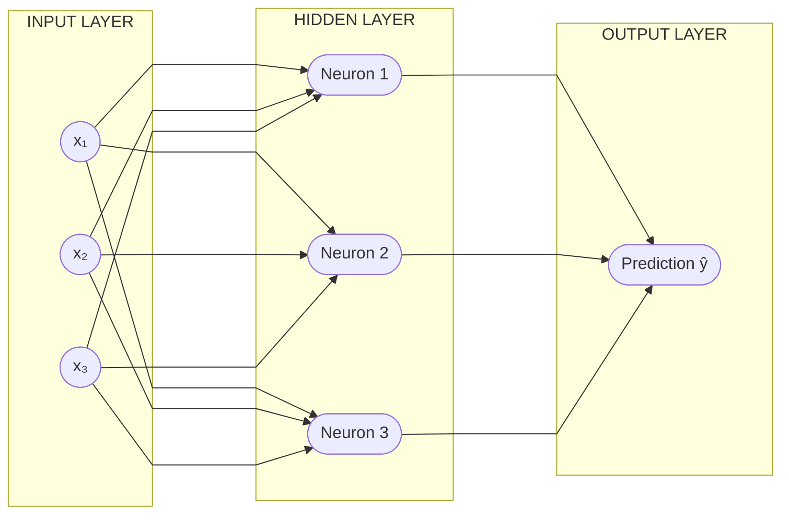

**How information flows:**

1. Input features (`x₁, x₂, x₃`) enter the network.
2. Each connection scales the input by a learned **weight** (`w`).
3. Neurons combine weighted inputs with a **bias** (`b`) and apply an **activation function**.
4. The output layer produces a prediction (`ŷ`).

Important terms:

- **Inputs (x₁, x₂, x₃):** Input features.
- **Weights (w₁, w₂, w₃):** Parameters that determine the influence of inputs.
- **Bias (b):** A parameter added to the weighted sum.
- **Activation function:** Applies a transformation to the weighted sum.
- **Forward propagation:** Information moves from input through the network to produce an output.
- **Loss:** Measures how far a prediction is from the expected answer.
- **Backpropagation:** Calculates gradients used to adjust weights during training.
- **Inference:** Using a trained model to make a prediction.

A simplified neuron calculation is:

`output = activation(x₁w₁ + x₂w₂ + x₃w₃ + b)`

**Worked example (illustrative numbers):**

Suppose one neuron receives inputs `x₁ = 1`, `x₂ = 0`, and `x₃ = 1`, with weights `w₁ = 0.5`, `w₂ = -0.2`, `w₃ = 0.8`, and bias `b = 0.1`.

```text
weighted sum = (1 × 0.5) + (0 × -0.2) + (1 × 0.8) + 0.1
             = 1.4
```

If the activation function is sigmoid, the output is approximately `0.80`. In a suitable binary-classification setup, this could be interpreted as a score for the positive class. The numbers are for learning only, not a trained model.

For a classification task, the output might be a class or a probability, such as spam/not spam.

### Neural-network training loop

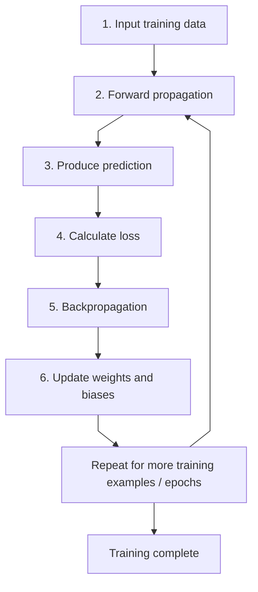

1. Pass inputs through the network (forward propagation).
2. Compare the prediction with the expected answer and calculate the loss.
3. Backpropagate the error and update the weights.
4. Repeat over training examples.

## 4. What Is a Large Language Model (LLM)?

An LLM is a model trained on large amounts of text to learn language patterns. Depending on its design and training, it can perform tasks such as:

- Answering questions and working with text
- Generating text
- Translating languages
- Summarizing content
- Assisting with code

**Simplified interaction flow:**

`Prompt / query → LLM → Response`

The model generates a response based on patterns learned during training and the context provided. Its output can be useful, but it is not guaranteed to be correct; verify important information.

**Examples:**

| Task | Example prompt | Example output |
|---|---|---|
| Question answering | “What is the capital of India?” | “New Delhi.” |
| Summarization | “Summarize this meeting note in three bullets.” | Three concise bullets |
| Translation | “Translate ‘Good morning’ into French.” | “Bonjour.” |
| Code assistance | “Write a Python function that adds two numbers.” | A Python function |

These are illustrative outputs. A model can make mistakes, so verify important facts and generated code.

## 5. What Are Tokens?

LLMs process text as **tokens** rather than directly processing whole words as people see them. A token can be a word, part of a word, punctuation, or another text unit.

Key points:

- **Tokenization** converts text into tokens.
- Tokens are represented internally by **token IDs**.
- A token ID is a numeric identifier for a token.
- One word does not always equal one token: a word may map to multiple tokens, and some tokens may include spaces or punctuation.

**Example:** The sentence `"AI models learn patterns."` is split into tokens before processing. Depending on the tokenizer, a token might be a whole word, part of a word, punctuation, or a word with a leading space. The exact token boundaries and token IDs vary by tokenizer; do not assume one word always equals one token.

Try the tokenizer: [OpenAI Tokenizer](https://platform.openai.com/tokenizer).

## 6. What Is a Context Window?

A context window is the amount of tokenized information a model can consider in a single interaction.

Depending on the model and application, the context may include:

- The current prompt or query
- Relevant conversation history
- Other supplied content, such as documents or tool results
- The model's response

The context window is measured in tokens. If the total content exceeds the model's limit, some content may need to be removed, shortened, or summarized.

**Example:** In a conversation about planning a trip, the context may include the original request, budget, dates, preferences, relevant follow-up messages, and the response being generated. If a long conversation or document exceeds the model's context limit, the application may need to shorten it, retrieve only relevant sections, or summarize earlier details.

A larger context window allows a model to process more information at once, but it does not automatically guarantee better answers. Context limits vary by model and version, so check the model's current documentation rather than relying on fixed figures.

## 7. What Are Vectors and Embeddings?

A **vector** is an ordered list of numbers, for example:

`[0.05, 0.3, 0.5]`

In machine learning, an **embedding** is a numerical vector representing an item such as text, an image, or another piece of data. Embeddings can encode useful semantic features so that similar items may have vectors that are close together in the embedding space.

A simple illustration might assign different IDs to words such as “cat,” “dog,” and “lion,” but these single numbers are not real semantic embeddings. Real embeddings usually contain many dimensions.

**Example — semantic similarity:** Imagine a user searches for “How do I reset my password?” A semantic search system may retrieve a help article titled “Recover access to your account,” even though the wording differs, because their meanings are similar.

A tiny vector such as `[0.05, 0.3, 0.5]` is only a format example; actual embedding values and dimensions depend on the embedding model.

Embeddings are useful because they can:

- Represent semantic similarity
- Support semantic search and retrieval
- Help systems identify relationships between pieces of content

## 8. What Is Vectorization?

Vectorization is the process of converting data into a numerical representation that a machine-learning system can process. In text and LLM applications, text may be converted into embeddings.

**Simplified flow:**

`Text → Tokenization / model processing → Vector (embedding)`

**Example:** An application stores embeddings for several help articles. When a user asks, “How can I change my login password?”, it converts the query into an embedding and compares it with the stored article embeddings. It can then retrieve a relevant article such as “Resetting your account password.”

Embeddings can help an application retrieve text that is semantically related to a user's question.

## 9. What Is a Vector Embedding?

A vector embedding is a numerical representation of data—such as a word, sentence, document, or image—in a vector space. It is designed to capture useful characteristics of the item.

**Example:** Two sentences—“My car needs repair” and “I need to fix my vehicle”—use different words but have similar meanings. An embedding model may map them to nearby points in vector space. The vectors shown in this example are conceptual; real embeddings are model-generated arrays with many dimensions.

In short, an embedding is a numerical representation that helps a system compare meaning or similarity.

## 10. What Is Attention?

Attention is a mechanism used by Transformer-based models to determine which parts of the input are relevant to one another when processing a sequence.

For example, the meaning of the word “it” in a sentence depends on the surrounding words. Attention helps a model use context to represent relationships between tokens.

**Example — the word “bank”:**

- “She deposited money at the **bank**.” — surrounding words suggest a financial institution.
- “They had a picnic on the river **bank**.” — surrounding words suggest the land beside a river.

Attention helps a Transformer model use surrounding tokens to represent the appropriate context. It does not guarantee that the model will interpret every sentence correctly.


### Attention scores and vectors (continuation)

In Transformer models, an input token is represented by a vector. The model derives **query (Q), key (K), and value (V)** vectors from token representations.

- **Query:** What information is this token looking for?
- **Key:** What information does each token offer for matching?
- **Value:** What information is passed forward when a token is attended to?

The model compares queries with keys to calculate attention scores. These scores are normalized and used to combine value vectors. In scaled dot-product attention, the score calculation is commonly written as:

`Attention(Q, K, V) = softmax(QKᵀ / √dₖ)V`

Here, `dₖ` is the dimension of the key vectors. This is a mathematical operation performed by the model; it is not a manually written Python `if` statement.

**Simple intuition:** In “The animal didn't cross the street because it was tired,” attention can help the model relate “it” to “the animal,” depending on the learned representations and context.

## 11. What Is a Transformer?

A **Transformer** is a neural-network architecture that uses attention mechanisms to process sequences of data. Transformers are the foundation of many modern large language models.

A language model may include many Transformer blocks. A typical block contains an attention component and a feed-forward neural network (FFN), along with residual connections and normalization layers.

### Transformer architecture reference diagram

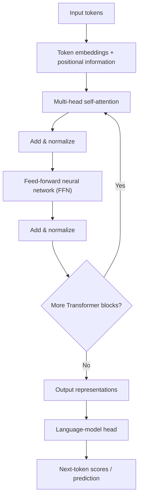

**How it works:**

1. The input text is tokenized.
2. Tokens are converted into vector embeddings; positional information helps represent token order.
3. Self-attention lets token representations incorporate information from other relevant tokens.
4. The feed-forward network further transforms each token representation.
5. The model repeats these operations across multiple layers.
6. For a generative language model, the final representations are used to score possible next tokens.

**Example:** For the prompt “The capital of India is …”, a language model uses the preceding context to score likely next tokens. “New” may be followed by “Delhi,” producing “New Delhi.” The model predicts tokens; it does not simply look up a fact in every case.

**Complexity note:** Standard self-attention has computation and memory costs that typically scale quadratically with sequence length, often described as (O(n^2)) in the sequence length (n). Implementations and newer attention variants can change practical costs.

## 12. What Is Fine-Tuning?

**Fine-tuning** means taking a pretrained model and training it further on a more specific dataset to adapt its behavior to a task or domain.

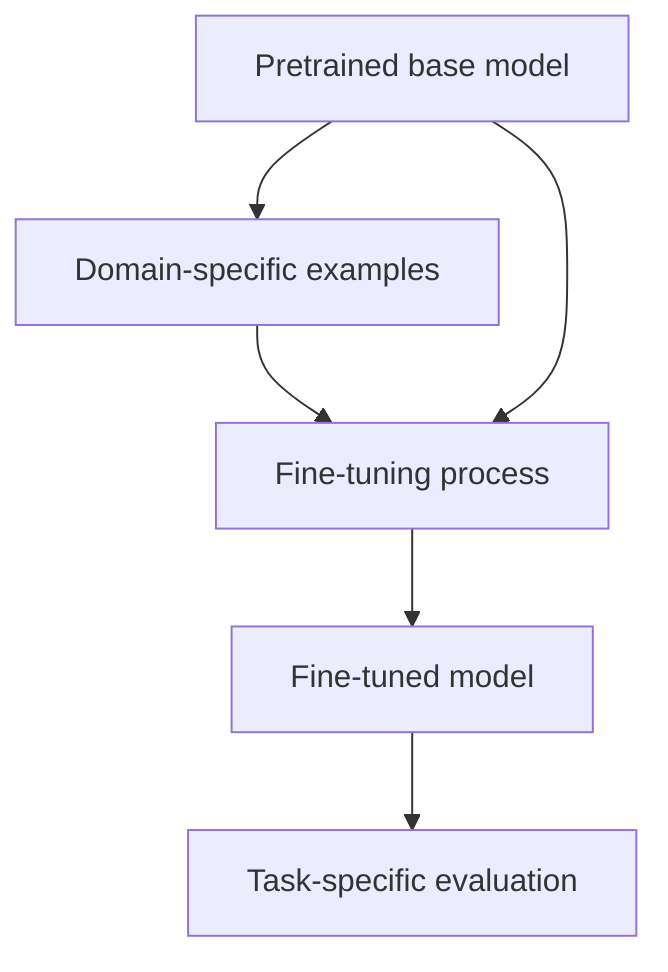

Possible domains and use cases include:

| Domain | Example use case |
|---|---|
| Medical | Classifying or summarizing clinical text under expert oversight |
| Finance | Categorizing financial documents or extracting defined fields |
| Legal | Classifying legal documents or assisting with clause extraction |

**Example:** A company has thousands of reviewed support messages labeled by category. It may fine-tune a suitable base model to classify new messages into those categories.

**Important distinction:** Fine-tuning changes model parameters. Supplying relevant documents through retrieval (RAG) gives the model extra information at response time without necessarily changing its parameters. Fine-tuning alone is not a reliable way to keep a model updated with every new fact.

## 13. What Is Self-Supervised Learning?

**Self-supervised learning** is a training approach in which a model creates a learning signal from the data itself, rather than relying entirely on humans to label every example.

A model may hide or remove part of the input and learn to predict it, or learn to predict the next token in a sequence.

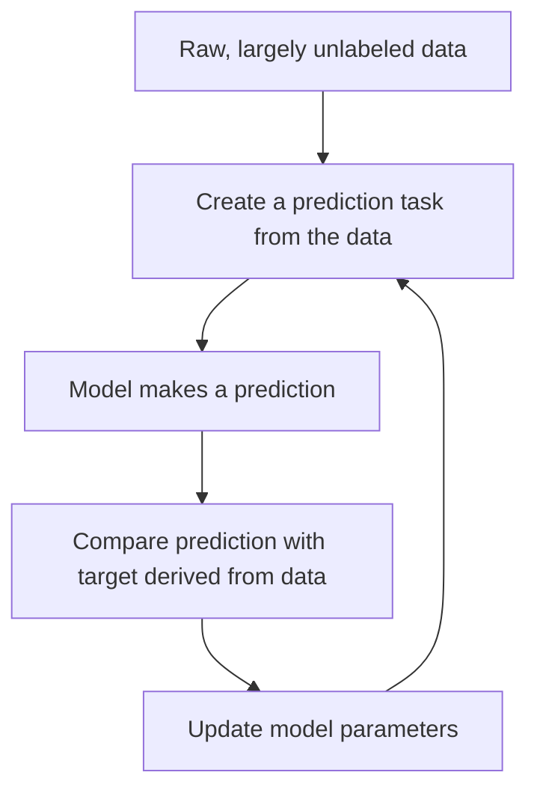

**Example — next-token prediction:** Given “The sun rises in the …”, the training target may be “east.” The model learns from many text sequences by predicting tokens from their preceding context.

**Another example — masked text:** A training sentence might be “Paris is the [MASK] of France.” The model learns to predict the missing word “capital.”

Self-supervised learning is widely used to pretrain language models. It is different from supervised learning, where examples are typically paired with labels supplied or reviewed by people.

## 14. What Is Reinforcement Learning?

**Reinforcement learning (RL)** is a machine-learning approach in which an **agent** takes actions in an **environment** and learns from rewards or penalties. The objective is to learn a policy that maximizes expected cumulative reward over time.

### Main components

| Component | Meaning |
|---|---|
| Agent | The learner or decision-making system |
| Environment | The world or system the agent interacts with |
| Action | A choice made by the agent |
| Reward | Feedback indicating how useful an outcome was |
| Policy | The strategy used to select actions |

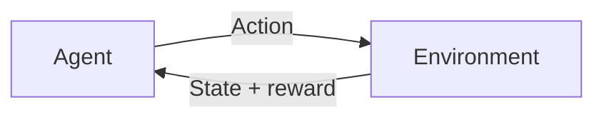

**Example — a maze:** An agent receives a positive reward for reaching the exit and a penalty for hitting obstacles. Over repeated attempts, it can learn actions that lead to higher cumulative rewards.

In some language-model training pipelines, reinforcement learning or related preference-optimization methods can be used to encourage responses that better match human preferences or specified goals. The exact training method varies by system.

## 15. What Is RAG (Retrieval-Augmented Generation)?

**Retrieval-Augmented Generation (RAG)** improves an LLM response by retrieving relevant information from an external knowledge source and providing that information to the model before it generates an answer.

### RAG workflow

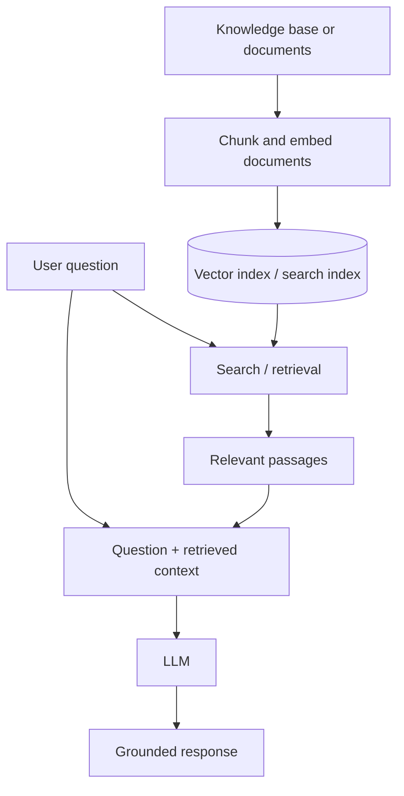

**Typical steps:**

1. Collect trusted source documents.
2. Split documents into smaller sections, often called **chunks**.
3. Generate embeddings for chunks and index them for retrieval.
4. Convert the user's question into a suitable search representation.
5. Retrieve relevant passages from the knowledge base.
6. Give the question and retrieved passages to the LLM.
7. Generate a response based on the supplied context, ideally with source references.

**Example — internal company policy:** An employee asks, “How many days of parental leave are available?” A RAG application retrieves the relevant section of the company's current policy and gives it to the LLM to formulate an answer.

**Benefits:** RAG can make answers more relevant to private or frequently updated information and can make source checking easier. It does not eliminate hallucinations; quality depends on retrieval, document freshness, prompt design, and model behavior. Access controls must be enforced so users only retrieve documents they are allowed to see.

## 16. What Is a Vector Database?

A **vector database** stores and searches vector representations (embeddings). It is often used to retrieve items whose embeddings are similar to a query embedding.

### Indexing and query flow

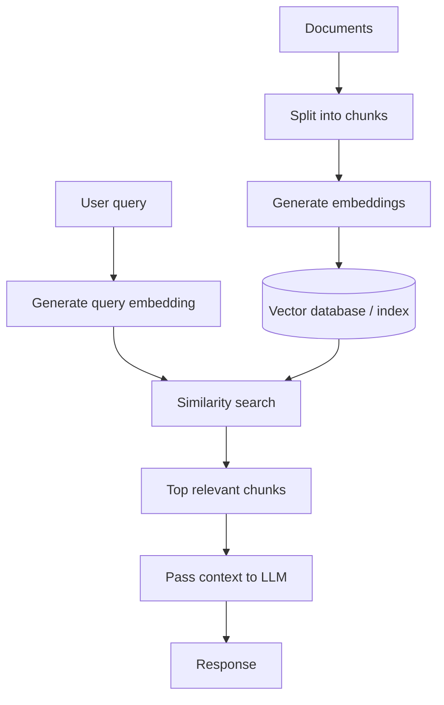

**Example:** A help center contains articles about password resets, account recovery, billing, and delivery. A user asks, “I can't sign in because I forgot my password.” Vector search can retrieve the account-recovery article even if it does not use the exact phrase “forgot my password.”

### Common concepts

- **Chunking:** Splitting documents into manageable pieces for retrieval.
- **Embedding:** Converting each chunk into a vector representation.
- **Similarity search:** Ranking vectors by a measure of closeness, such as cosine similarity or distance.
- **Metadata filtering:** Restricting results by attributes such as document type, date, or access permissions.
- **Top-k retrieval:** Returning a selected number of the highest-ranked results.

A vector database is not always required for RAG; smaller systems can use other search indexes, including keyword or hybrid search. The best choice depends on data size, search needs, latency, and operational constraints.

## 17. What Is Few-Shot Prompting?

**Few-shot prompting** means providing a model with a small number of examples in the prompt to show the format or pattern expected in its response. The examples guide the model at inference time; they do not, by themselves, update the model's weights.

### Zero-shot, one-shot, and few-shot

| Technique | What the prompt includes | Example |
|---|---|---|
| Zero-shot | Instructions, no examples | “Classify this review as positive or negative: ‘The service was excellent.’” |
| One-shot | One example | “Review: ‘I loved it.’ Label: Positive. Now label: ‘The service was excellent.’” |
| Few-shot | A few examples | “Review: ‘Loved it.’ → Positive; ‘Terrible wait.’ → Negative; now classify: ‘The service was excellent.’” |

**Example prompt:**

```text
Classify each review as Positive or Negative.

Review: "Fast delivery and great quality."
Label: Positive

Review: "The item arrived broken."
Label: Negative

Review: "Works perfectly and looks great."
Label:
```

Expected output: `Positive`

Few-shot examples are useful for demonstrating output structure, style, and classification criteria. Choose representative examples and avoid including sensitive information unnecessarily.

## 18. What Is the Model Context Protocol (MCP)?

The **Model Context Protocol (MCP)** is an open protocol that standardizes how AI applications connect to external tools and data sources. It can allow an AI application to discover and invoke tools or access permitted resources through MCP servers.

### Simplified MCP interaction

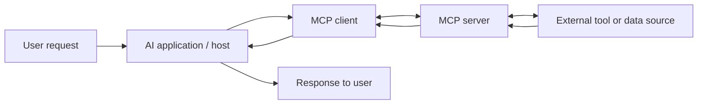

**Main parts:**

- **Host:** The AI application coordinating the interaction.
- **MCP client:** The component that communicates with an MCP server.
- **MCP server:** Exposes permitted tools, resources, or prompts through the protocol.
- **External system:** For example, a database, file service, or business application.

**Example — company knowledge search:** A user asks, “Find the latest approved travel policy.” The AI application can use an authorized MCP server to query a company document system, receive relevant results, and use them to prepare an answer.

MCP defines how components communicate; it does not automatically grant access to every external system. Configure authentication, authorization, and tool permissions carefully, and validate tool outputs before taking consequential actions.

## 19. What Is Context Engineering?

**Context engineering** is the practice of selecting, structuring, and managing the information supplied to an LLM so it has the right context for a task. It goes beyond writing a single prompt.

Context may include:

- System and task instructions
- The user's current request and relevant preferences
- Relevant conversation history or a summary of it
- Retrieved documents and other RAG results
- Few-shot examples
- Tool definitions and results, including tools accessed through MCP
- Structured data or other task-specific information

### Context-engineering workflow

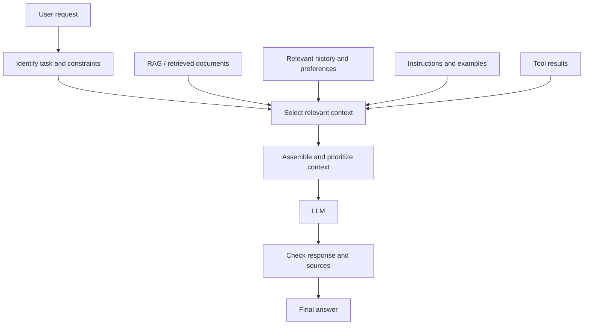

**Example — travel assistant:** A user asks for a three-day trip plan. Useful context might include the destination, travel dates, budget, mobility needs, previously stated preferences, and current opening hours retrieved from trusted sources. Unrelated conversation history should be left out.

**Good practices:**

1. Include information relevant to the current task rather than everything available.
2. Put important instructions and constraints where the model can clearly use them.
3. Retrieve current facts when needed instead of relying only on model memory.
4. Summarize long histories carefully and preserve critical details.
5. Track token usage so the context fits within the model's limits.
6. Protect private data and apply access controls to retrieved documents and tools.
7. Evaluate outputs for correctness, relevance, and whether they follow the instructions.

**How the concepts fit together:** RAG supplies relevant external knowledge; few-shot prompting supplies examples; MCP connects the AI application to tools and data; context engineering decides how these and other inputs are selected and assembled for the model.


## 20. What Is a Multimodal Model?

A **multimodal model** can process or work with more than one type of input or output, such as text, images, audio, and video. Some models accept multiple modalities as input; others can also generate content in different modalities. Capabilities vary by model.

Common modalities include:

- Text
- Images
- Audio and speech
- Video
- Documents that contain text, tables, or images

**Example:** A user uploads a photo of a restaurant menu and asks, “Which dishes are vegetarian?” A multimodal model can inspect the image and answer in text. Another example is asking a model to summarize a meeting recording using its audio.

**Choosing a model:** Use a model that supports the required modality and quality level. For a simple text classification task, a smaller text-only model may be faster and less expensive than a multimodal model.

| Task | Input | Expected output |
|---|---|---|
| Image question answering | Photo of a street sign | Text describing the sign |
| Audio transcription | Speech recording | Written transcript |
| Video summarization | Video clip | Summary of key events |
| Document understanding | PDF containing text and tables | Extracted fields or a summary |
| Text generation | Written prompt | Generated text |

### Multimodal interaction diagram

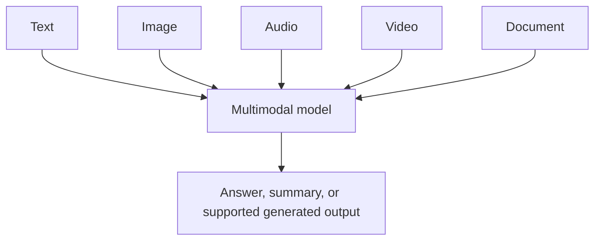

A model may not support every input/output combination. Check its documented capabilities, file limits, and supported formats.

## 21. What Is an AI Agent?

An **AI agent** is a system that uses a model to pursue a goal by choosing steps, using available tools, observing results, and deciding what to do next. Unlike a simple one-shot prompt-and-response flow, an agent can run a multi-step workflow when the application allows it.

### Basic agent workflow

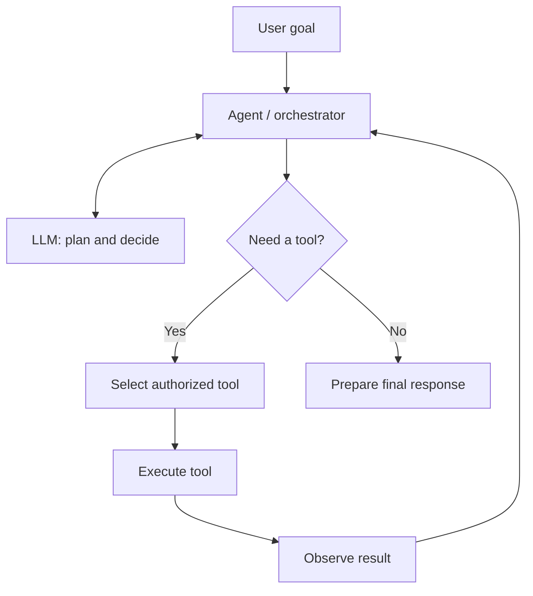

**Example — engineering assistant:** A user asks, “Find the failing tests and explain the likely cause.” An appropriately authorized agent could:
1. Inspect the test output.
2. Search relevant source files.
3. Run an approved test command.
4. Compare the failure with the code.
5. Summarize the evidence and suggest a fix.

The agent should not be granted unrestricted access just because it uses an LLM. Use least-privilege tool permissions, validate tool inputs and outputs, require confirmation for risky actions, and log important operations.

### Example: an agent using MCP clients and servers

The following conceptual diagram shows an agent coordinating multiple tool connections. An MCP client communicates with an MCP server; the server exposes the tools or resources it is authorized to provide.

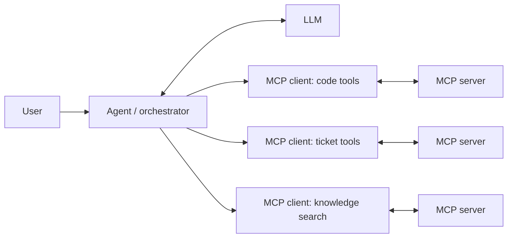

**Example:** An engineering agent may use one approved tool connection to inspect a repository, another to read issue tickets, and another to search technical documentation. The agent combines the returned information into one response. Tool access and confirmation rules should be enforced by the application, not left solely to the model.

## 22. What Is Chain of Thought and Reasoning in LLMs?

**Chain-of-thought prompting** is a technique that encourages a model to work through a task in intermediate steps before producing an answer. Modern systems may also use reasoning-oriented models that spend additional computation on difficult problems. Their internal reasoning mechanisms differ by model and are not necessarily exposed to the user.

Related approaches and terms include:

- **Step-by-step prompting:** Ask for a structured explanation or solution process.
- **Tree of thoughts:** Explore and compare multiple candidate approaches.
- **Graph of thoughts:** Represent relationships among intermediate ideas or partial solutions.
- **Reasoning model:** A model optimized or configured to perform more deliberate multi-step problem solving.

These labels describe different approaches and are not interchangeable guarantees of correctness.

**Example — a math problem:** Instead of only asking “What is 18% of 250?”, request a concise calculation:
1. Convert 18% to 0.18.
2. Multiply 250 by 0.18.
3. Return 45.

**Example — debugging:** Ask the model to list plausible causes of a failing API test, identify what evidence would distinguish them, and recommend the next diagnostic check. This encourages a verifiable process rather than an unsupported guess.

### Simple answer flow vs. structured reasoning task

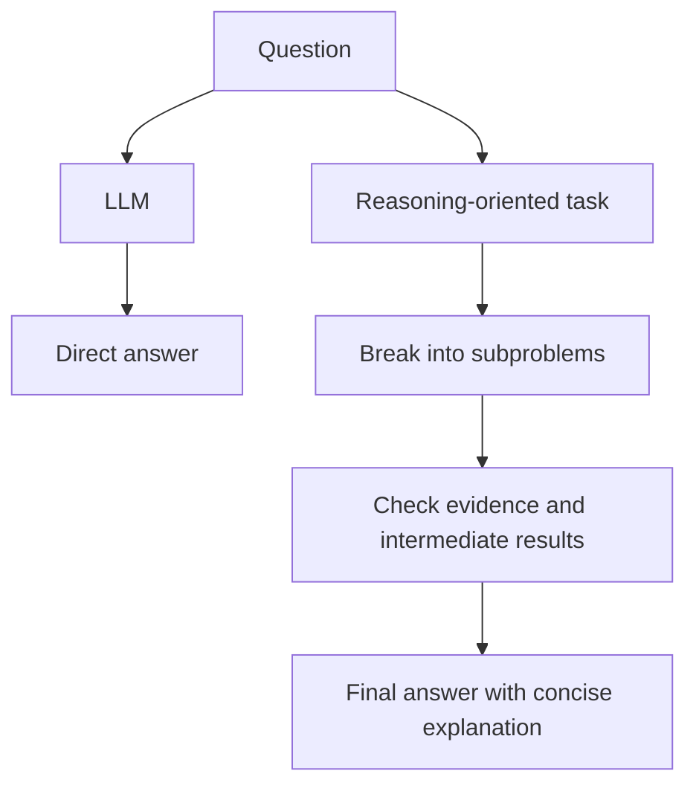

**Important:** A detailed explanation can still be wrong. For high-impact decisions, validate calculations, use reliable sources or tools, and check the final result. Applications should request a useful explanation or summary rather than depend on access to a model's private internal reasoning.

## 23. What Is a Small Language Model (SLM)?

A **small language model (SLM)** is a language model with a comparatively smaller number of parameters or a more compact design than larger models. There is no single parameter-count cutoff that universally defines an SLM.

SLMs can be useful when an application needs lower latency, reduced compute cost, local deployment, or a model specialized for a narrower task. They may be less capable than larger models on some complex or broad tasks, so performance must be evaluated for the intended use.

**Potential use cases:**

- Classifying support tickets
- Extracting fields from structured business documents
- Summarizing short internal notes
- Running language features on-device or in a constrained environment
- Domain-specific assistants, including carefully evaluated legal or medical support tools

| Consideration | Smaller model | Larger model |
|---|---|---|
| Inference cost | Often lower | Often higher |
| Latency | Often lower | Can be higher |
| Deployment footprint | Often smaller | Often larger |
| Complex reasoning and broad knowledge | May be more limited | May perform better, depending on the model |
| Best choice | Narrow, well-defined tasks | Tasks that justify additional capability and cost |

**Example:** A help desk receives thousands of short tickets each day. A small model fine-tuned or prompted to categorize tickets as “billing,” “login,” or “delivery” may be more cost-effective than using a large model for every ticket. Evaluate accuracy, latency, privacy, and error-handling before deployment.

## 24. What Is Knowledge Distillation?

**Knowledge distillation** is a technique for training a smaller **student model** to reproduce useful behavior from a larger **teacher model**. The goal is to retain as much task performance as practical while reducing inference cost or deployment requirements.

### Distillation workflow

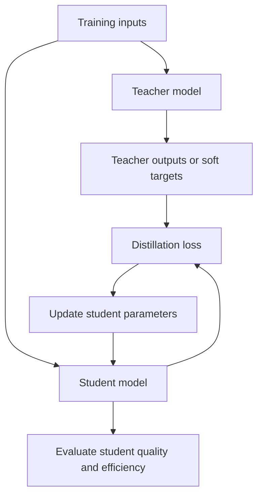

**Typical process:**
1. Choose a capable teacher model and define the target task.
2. Prepare representative training inputs.
3. Generate teacher outputs, labels, or probability distributions as appropriate.
4. Train the student to match the desired teacher behavior, often alongside ordinary task labels.
5. Evaluate the student on held-out examples and deployment requirements.

**Example:** A large model generates or labels representative support-ticket examples. A smaller student is trained to classify new tickets into the same categories. The student can be deployed at lower cost if it meets the required quality threshold.

**Important:** Distillation does not guarantee that the student matches the teacher. It may inherit teacher mistakes or lose capabilities, so compare both models on representative test data, including edge cases.

## 25. What Is Quantization?

**Quantization** reduces the numerical precision used to represent model weights and sometimes activations. For example, a model may use lower-bit representations instead of storing all weights in 32-bit floating-point format. This can reduce memory use and may improve inference speed, depending on hardware and implementation.

### Conceptual quantization diagram

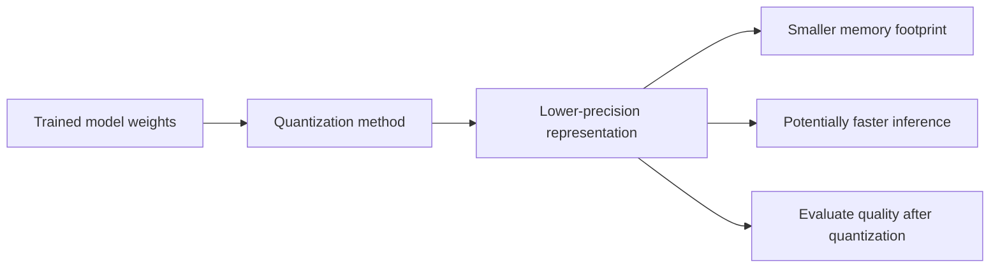

**Illustrative storage comparison:** If the same number of weights could be represented at the stated bit widths, the raw weight storage per parameter would be:

| Precision | Bits per weight | Approximate raw storage per weight |
|---|---:|---:|
| 32-bit | 32 | 4 bytes |
| 16-bit | 16 | 2 bytes |
| 8-bit | 8 | 1 byte |
| 4-bit | 4 | 0.5 byte |

These figures are theoretical raw storage estimates; real model memory also includes metadata, scales, runtime buffers, activations, and other overhead.

**Example:** A model is too large to fit comfortably in the memory available on a deployment machine. An engineer tests an 8-bit or 4-bit quantized version and measures memory, latency, and task quality. If the quality loss is acceptable, the quantized version may be a better deployment choice.

### Two common quantization stages

1. **Post-training quantization (PTQ):** Quantize a model after its main training process. Some methods use a calibration dataset to estimate activation ranges.
2. **Quantization-aware training (QAT):** Simulate quantization effects during training so the model can adapt to lower precision before deployment.

**How distillation differs from quantization:** Distillation trains a student model to imitate a teacher; quantization changes the numerical representation used by a model. They can also be combined when evaluation shows a benefit.
