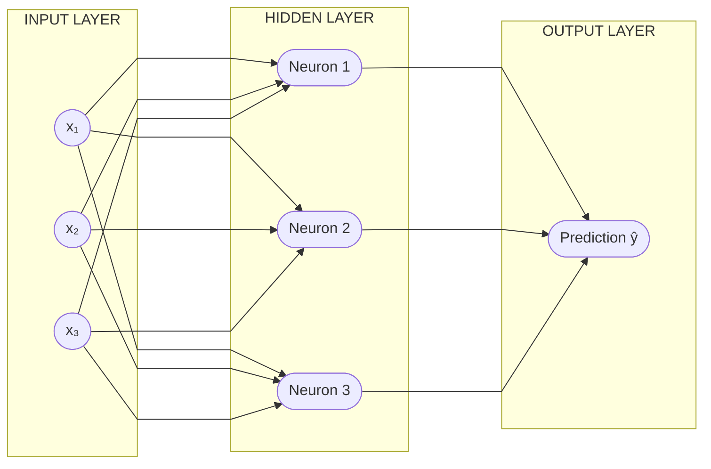
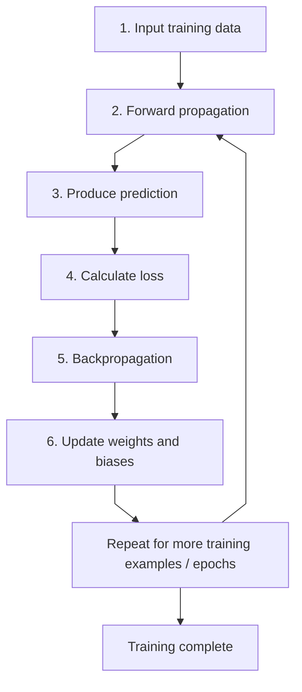

# AI, Machine Learning, Deep Learning, and LLM Fundamentals

## 1. How Does AI Learn?

AI learns by recognizing patterns in data. Data is fed to a model, which learns patterns and uses them to make predictions.

**Basic flow:**

`Data → Patterns (mathematics) → ML model → Prediction`

The model is trained using data. During inference, the trained model uses what it learned to make a prediction.

**Example:** Given examples of emails labeled “spam” and “not spam,” a model can learn patterns and predict whether a new email is spam.

## 2. What Is AI?

Artificial intelligence (AI) refers to systems designed to perform tasks that typically require human intelligence.

AI, machine learning, and deep learning are related fields:

- **AI** is the broadest field.
- **Machine learning (ML)** is a subset of AI in which systems learn patterns from data.
- **Deep learning (DL)** is a subset of ML that uses neural networks with multiple layers.

Relationship:

```text
AI
└── Machine Learning (ML)
    └── Deep Learning (DL)
```

## 3. What Is a Neural Network?

A neural network is a system of interconnected artificial neurons. It is loosely inspired by how biological neurons communicate.

A typical neural network has:

- **Input layer:** Receives the input features.
- **Hidden layer(s):** Transform the information.
- **Output layer:** Produces a prediction.

### Reference diagram: Neural network

The diagram below shows a simple feed-forward neural network. Each connection has a weight; neurons combine their inputs with a bias and apply an activation function.



**How information flows:**

1. Input features (`x₁, x₂, x₃`) enter the network.
2. Each connection scales the input by a learned **weight** (`w`).
3. Neurons combine weighted inputs with a **bias** (`b`) and apply an **activation function**.
4. The output layer produces a prediction (`ŷ`).

Important terms:

- **Inputs (x₁, x₂, x₃):** Input features.
- **Weights (w₁, w₂, w₃):** Parameters that determine the influence of inputs.
- **Bias (b):** A parameter added to the weighted sum.
- **Activation function:** Applies a transformation to the weighted sum.
- **Forward propagation:** Information moves from input through the network to produce an output.
- **Loss:** Measures how far a prediction is from the expected answer.
- **Backpropagation:** Calculates gradients used to adjust weights during training.
- **Inference:** Using a trained model to make a prediction.

A simplified neuron calculation is:

`output = activation(x₁w₁ + x₂w₂ + x₃w₃ + b)`

For a classification task, the output might be a class or a probability, such as spam/not spam.

### Neural-network training loop



1. Pass inputs through the network (forward propagation).
2. Compare the prediction with the expected answer and calculate the loss.
3. Backpropagate the error and update the weights.
4. Repeat over training examples.

## 4. What Is a Large Language Model (LLM)?

An LLM is a model trained on large amounts of text to learn language patterns. Depending on its design and training, it can perform tasks such as:

- Answering questions and working with text
- Generating text
- Translating languages
- Summarizing content
- Assisting with code

**Simplified interaction flow:**

`Prompt / query → LLM → Response`

The model generates a response based on patterns learned during training and the context provided. Its output can be useful, but it is not guaranteed to be correct; verify important information.

**Example question:** “What is the capital of India?”

An LLM may answer “New Delhi.” This illustrates generating a likely response from learned language patterns, not a guarantee that every answer is accurate.

## 5. What Are Tokens?

LLMs process text as **tokens** rather than directly processing whole words as people see them. A token can be a word, part of a word, punctuation, or another text unit.

Key points:

- **Tokenization** converts text into tokens.
- Tokens are represented internally by **token IDs**.
- A token ID is a numeric identifier for a token.
- One word does not always equal one token: a word may map to multiple tokens, and some tokens may include spaces or punctuation.

Try the tokenizer: [OpenAI Tokenizer](https://platform.openai.com/tokenizer).

## 6. What Is a Context Window?

A context window is the amount of tokenized information a model can consider in a single interaction.

Depending on the model and application, the context may include:

- The current prompt or query
- Relevant conversation history
- Other supplied content, such as documents or tool results
- The model's response

The context window is measured in tokens. If the total content exceeds the model's limit, some content may need to be removed, shortened, or summarized.

A larger context window allows a model to process more information at once, but it does not automatically guarantee better answers. Context limits vary by model and version, so check the model's current documentation rather than relying on fixed figures.

## 7. What Are Vectors and Embeddings?

A **vector** is an ordered list of numbers, for example:

`[0.05, 0.3, 0.5]`

In machine learning, an **embedding** is a numerical vector representing an item such as text, an image, or another piece of data. Embeddings can encode useful semantic features so that similar items may have vectors that are close together in the embedding space.

A simple illustration might assign different IDs to words such as “cat,” “dog,” and “lion,” but these single numbers are not real semantic embeddings. Real embeddings usually contain many dimensions.

Embeddings are useful because they can:

- Represent semantic similarity
- Support semantic search and retrieval
- Help systems identify relationships between pieces of content

## 8. What Is Vectorization?

Vectorization is the process of converting data into a numerical representation that a machine-learning system can process. In text and LLM applications, text may be converted into embeddings.

**Simplified flow:**

`Text → Tokenization / model processing → Vector (embedding)`

Embeddings can help an application retrieve text that is semantically related to a user's question.

## 9. What Is a Vector Embedding?

A vector embedding is a numerical representation of data—such as a word, sentence, document, or image—in a vector space. It is designed to capture useful characteristics of the item.

In short, an embedding is a numerical representation that helps a system compare meaning or similarity.

## 10. What Is Attention?

Attention is a mechanism used by Transformer-based models to determine which parts of the input are relevant to one another when processing a sequence.

For example, the meaning of the word “it” in a sentence depends on the surrounding words. Attention helps a model use context to represent relationships between tokens.

Attention helps a model relate tokens within the available context; it does not guarantee that the model will understand code or natural language correctly.
